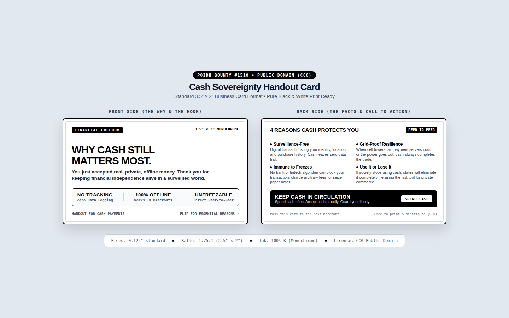

# Cash Sovereignty Handout Card (Standard 3.5" × 2")

> **POIDH Bounty #1510 Deliverable** — Monochromatic, high-contrast, print-ready business-card sized handout advocating the essential freedom, privacy, and offline resilience of physical cash in an increasingly surveilled society.

---

## 🎯 Specifications & Print Standards

* **Standard Business Card Ratio**: 3.5" × 2" (1.75:1 ratio, 1050 × 600 px @ 300 DPI)
* **Color Palette**: Pure Monochrome (100% K Black & White only, zero color ink required)
* **Standard Bleed**: 0.125" standard trim lines supported
* **Typography**: Space Grotesk (Headlines) + Plus Jakarta Sans (Body) + JetBrains Mono (Badges & Metadata)
* **License**: Public Domain (CC0 1.0 Universal) — Free for anyone to print, duplicate, and distribute with cash payments.

---

## 📄 Card Architecture

### Front Side: The Hook & The Thank You
* **Tag**: `FINANCIAL FREEDOM • 3.5" × 2" MONOCHROME`
* **Headline**: **WHY CASH STILL MATTERS MOST.**
* **Message**: *"You just accepted real, private, offline money. Thank you for keeping financial independence alive in a surveilled world."*
* **3 Core Value Pillars**:
  1. **NO TRACKING** — Zero data logging or purchase tracking.
  2. **100% OFFLINE** — Fully operational during power grid outages and telecom failures.
  3. **UNFREEZABLE** — Direct peer-to-peer settlement without intermediary approval.

### Back Side: The 4 Reasons & The Call to Action
* **Header**: **4 REASONS CASH PROTECTS YOU** `[PEER-TO-PEER]`
* **The 4 Essential Pillars**:
  1. **Surveillance-Free**: Digital transactions log your identity, location, and purchase history. Cash leaves zero data trail.
  2. **Grid-Proof Resilience**: When cell towers fail, payment servers crash, or the power goes out, cash always completes the trade.
  3. **Immune to Freezes**: No bank or fintech algorithm can block your transaction, charge arbitrary fees, or seize paper notes.
  4. **Use It or Lose It**: If society stops using cash, states will eliminate it completely—erasing the last tool for private commerce.
* **Call to Action**:
  * **KEEP CASH IN CIRCULATION** — *"Spend cash often. Accept cash proudly. Guard your personal liberty."*
  * Action Badge: `[SPEND CASH]`

---

## 📦 Asset Files

* [`index.html`](index.html): Interactive high-resolution side-by-side presentation preview with live render styles.
* [`card_front.svg`](card_front.svg): 300 DPI vector graphic of the Front side.
* [`card_back.svg`](card_back.svg): 300 DPI vector graphic of the Back side.
* [`cash_sovereignty_handout_card.png`](cash_sovereignty_handout_card.png): Combined print-ready preview render.

---

## 👤 Creator Attribution
* **Created for**: POIDH Bounty #1510
* **Author**: @RizulChauhan
* **Payout Address**: `0xB0fc11e067c57aa0DCEB398747847c6F25a369A1` (Base)
